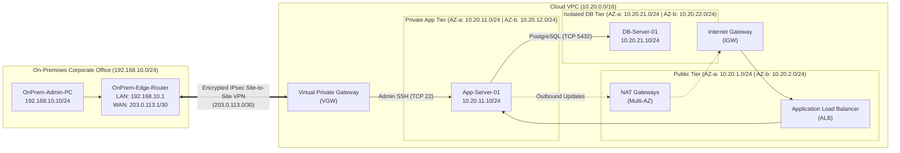

# Enterprise Hybrid Cloud VPC & Site-to-Site VPN Architecture

## Overview
A multi-tier, fault-tolerant hybrid cloud network architecture connecting an on-premises corporate branch (`192.168.10.0/24`) to a segmented Cloud VPC (`10.20.0.0/16`) across dual Availability Zones.

## Architecture Topology

## 1. CIDR Subnetting & Routing Matrix

| Tier | Availability Zone | Subnet CIDR | Usable Hosts | Default Route (`0.0.0.0/0`) | Hybrid Route (`192.168.10.0/24`) |
| :--- | :--- | :--- | :--- | :--- | :--- |
| **Public Tier** | AZ-a | `10.20.1.0/24` | 251 | Internet Gateway (IGW) | Virtual Private Gateway (VGW) |
| **Public Tier** | AZ-b | `10.20.2.0/24` | 251 | Internet Gateway (IGW) | Virtual Private Gateway (VGW) |
| **Private App Tier** | AZ-a | `10.20.11.0/24` | 251 | NAT Gateway (AZ-a) | Virtual Private Gateway (VGW) |
| **Private App Tier** | AZ-b | `10.20.12.0/24` | 251 | NAT Gateway (AZ-b) | Virtual Private Gateway (VGW) |
| **Isolated DB Tier** | AZ-a | `10.20.21.0/24` | 251 | *None (Air-gapped)* | Virtual Private Gateway (VGW) |
| **Isolated DB Tier** | AZ-b | `10.20.22.0/24` | 251 | *None (Air-gapped)* | Virtual Private Gateway (VGW) |

## 2. Defense-in-Depth Security Controls

### Stateful Security Groups (Instance Level)
- **ALB-SG (Public):** Inbound `TCP 80, 443` from `0.0.0.0/0`.
- **App-Tier-SG (Private):** Inbound `TCP 8080` strictly from `ALB-SG`; Inbound `TCP 22` (SSH) strictly from `192.168.10.0/24` (On-Premises Admin Subnet via VPN).
- **DB-Tier-SG (Isolated):** Inbound `TCP 5432` (PostgreSQL) strictly from `App-Tier-SG`. All direct SSH and external traffic denied.

### Stateless Network ACLs (Subnet Perimeter)
- **Isolated DB NACL:** Explicitly denies inbound traffic from `0.0.0.0/0` and permits traffic solely from `10.20.11.0/24` and `10.20.12.0/24` on database and ephemeral return ports (`1024-65535`).

## 3. Hybrid Connectivity & Verification Plan
- **Site-to-Site IPsec VPN:** Terminated between On-Premises Edge Router (`203.0.113.1/30`) and Cloud Virtual Private Gateway (`203.0.113.2/30`) using AES-256 encryption and SHA-256 hashing.
- **Verification Labs:** Validated OSPF route propagation, NAT masquerading for private app outbound updates, and extended ACL enforcement blocking direct on-premises-to-database access.
